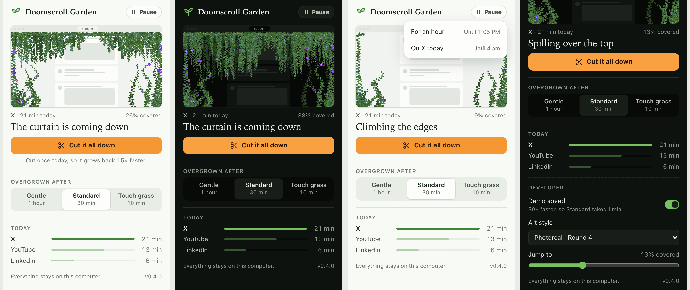

# Doomscroll Garden

A Chrome extension that lets vines take over your feeds while you scroll, the way ivy and morning glory take
over a wall: mounds in the bottom corners, climbers up the edges, a thick band along the top, and then a curtain
of hanging strands that veils the feed. Every flick of the feed pushes them further. Cut them down and they grow
back faster.

## Load it

It isn't on the Chrome Web Store, so load it yourself:

1. Download this repo (**Code → Download ZIP**, then unzip it) or `git clone` it.
2. Open `chrome://extensions` and turn on **Developer mode** (top right).
3. Click **Load unpacked** and pick the folder.
4. Pin the sprout icon, then open X, Instagram, Reddit, LinkedIn, YouTube, Bluesky or Facebook and scroll.

After changing code, click the reload arrow on the extension's card and refresh the feed tab.

## How it grows

- **Scrolling is what grows it.** While the page is moving (and for 0.7 s after), the vines grow 1.6× the base rate;
  while you read, watch or type they grow only 0.3×. So each flick shows as a push of growth, and with the usual mix
  of flicking and reading it averages out near the base rate. The drawn garden eases toward the real one, so the
  pushes look smooth.
- The first scroll on a fresh garden sprouts a couple of garden minutes at once, so you can see it start.
- Only **active** time counts: the tab is visible and focused, and you scrolled, typed or moved the mouse in the last minute.
- The growth follows garden minutes: mounds and bare reaching shoots in the bottom corners from the start, climbers
  up the window edges and any wide empty margin by about 8, a runner along the top from each corner by about 16,
  and from that band a curtain of strands hanging down at very different lengths, longest over the middle of the
  page, until about 30. By then roughly half the window is covered, and most of the feed is hard to read. It is a
  veil, not a wall: the page still shows between the strands.
- Some strands sit behind the others, in shade. Leaves are big near where a strand starts and tiny at its tip;
  morning glories open here and there, a few together.
- Butterflies arrive at 12, a dragonfly at 18, fireflies at 16 on dark pages. Click near one to startle it.
- **How long it takes** is picked in the popup under **Overgrown after**: Gentle (1 hour of scrolling), Standard
  (30 min, the default) or Touch grass (10 min). The pace only changes how fast the garden minutes pass; the vines
  grow the same way at every pace.
- **Demo speed** (off by default, in the developer drawer) runs everything 30× faster, so Standard is overgrown
  after about **1 minute**, Gentle after 2 and Touch grass after 20 seconds. Handy for trying it out or recording it.
- Ten minutes away from a site clears its garden. The day's totals reset at 4 am.
- The vines only block the view. Clicks and scrolling still reach the page underneath.

## Cutting it down

- **Cut it down** (bottom right of the page, once there are vines) or **Cut it all down** in the popup sends a pair of
  shears along the band at the top, starting from the side nearest where you cut. Each hanging strand drops whole
  as soon as its top is snipped, the band comes away in pieces, the climbers come off the window edges and the
  corner mounds sink. A few leaves come loose and flutter down.
- Every cut today makes the vines grow back 50% faster, up to 3×. A note says so after each cut, and the popup
  shows how many times you've cut today.

## Art styles

Photoreal is the default. The others are in the popup's developer drawer: Pixel vines, Chunky pixel, 1-bit dither,
ASCII, Cross-stitch, Ink line, Watercolour, Paper cut-out and Illustrated. They all draw the same vines, so you can
compare them on a real feed.

**Jump to** in the developer drawer sets this site's garden to any point, so you can see a style fully overgrown without
waiting.

Every site grows morning glory for now, each with its own flower colour.

## The popup

- A miniature of the page with this site's vines on it, drawn by the same code as the real overlay, on a mock feed.
  Off a feed, it shows a preview halfway in. The vines climb in when the popup opens.
- What stage the garden is at, how much is covered and today's time on the site, then **Cut it all down**.
- **Overgrown after**: Gentle, Standard or Touch grass.
- **Today**: the three sites you scrolled longest today.
- **Pause** (top right): for an hour, or on this site until 4 am. While paused it reads **Resume**.
- **Developer drawer**: click the version number at the bottom right. It has demo speed, the art style and
  **Jump to**. It stays open until you click the version number again.

The popup follows the system's light or dark mode and fits in Chrome's 600 px popup height.

## Pause

Pause for an hour, or for one site until 4 am, from the popup. The garden is hidden while paused
and in fullscreen. Respects reduced motion (no creatures; a cut fades out instead of falling).
Everything stays in `chrome.storage.local`.

## Files

- `src/content.js`: activity tracking, the overlay (in a shadow root), the cut button, the frame loop
- `src/overgrowth.js`: the vines: corner mounds, edge climbers, the top runner and the hanging curtain, and when each part appears
- `src/styles.js`: the art styles, each drawing the same scene its own way
- `src/cut.js`: the cut-down animation: each part of the garden is painted once, then moved
- `src/margins.js`: finds the empty margins, which fill first
- `src/creatures.js`: butterflies, dragonflies, fireflies (flight ported from ascii-animals, see `THIRD_PARTY_NOTICES.md`)
- `src/atlas.js`, `art/atlas.png`: the pixel-vines sprite atlas, generated
- `art/photo/`: the keyed morning-glory photos for the photoreal style
- `popup/`: the toolbar popup (it loads `overgrowth.js` and `styles.js` to draw its miniature)
- `tools/`: the pixel source art and `bake.mjs`, which rebuilds the atlas and icons (`node tools/bake.mjs`, needs Google Chrome)
- `docs/`: the pictures in this README

## Privacy

No accounts, no network requests, no analytics. The extension only runs on the feed sites listed in
`manifest.json`, and everything it keeps (garden progress, minutes per site, settings) stays in
`chrome.storage.local` on your computer.

## License

MIT, see `LICENSE`. The butterfly and dragonfly flight is ported from ascii-animals (MIT), see `THIRD_PARTY_NOTICES.md`.
